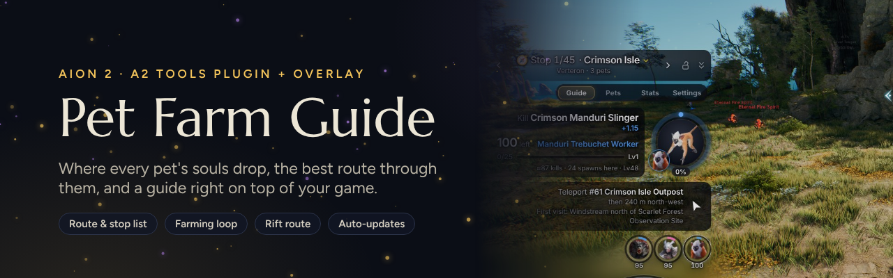
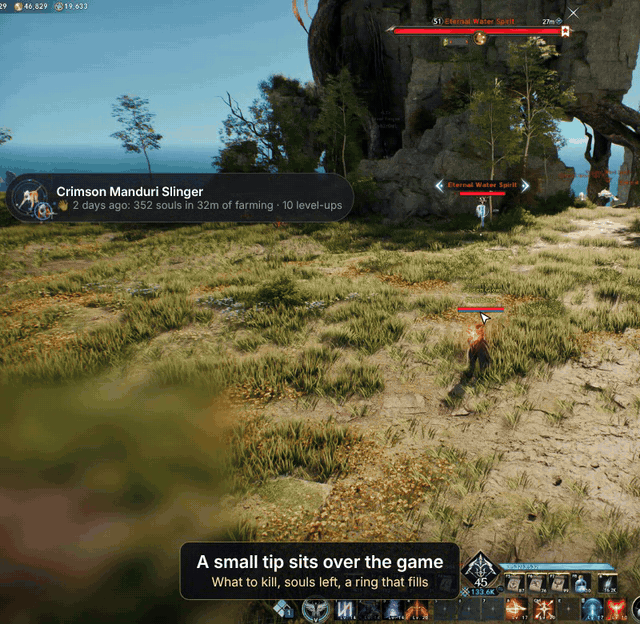
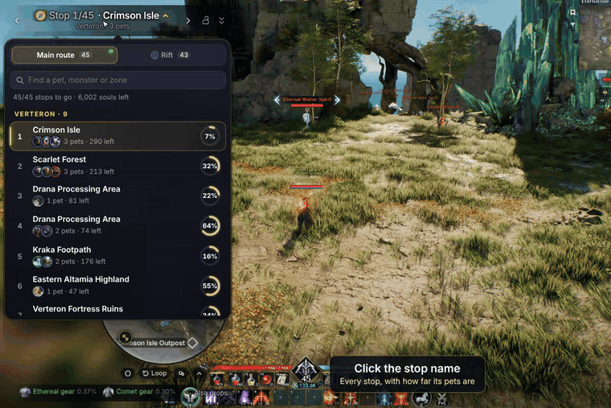
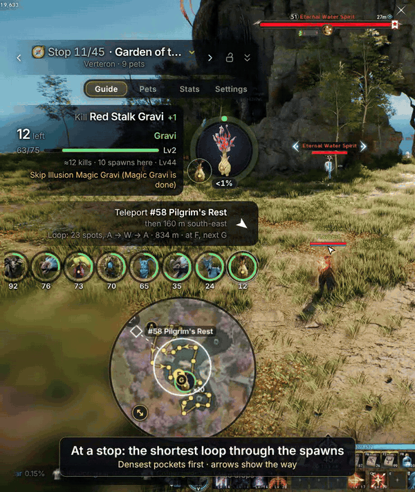
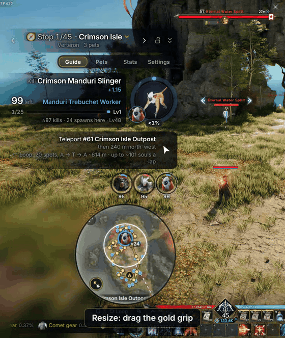
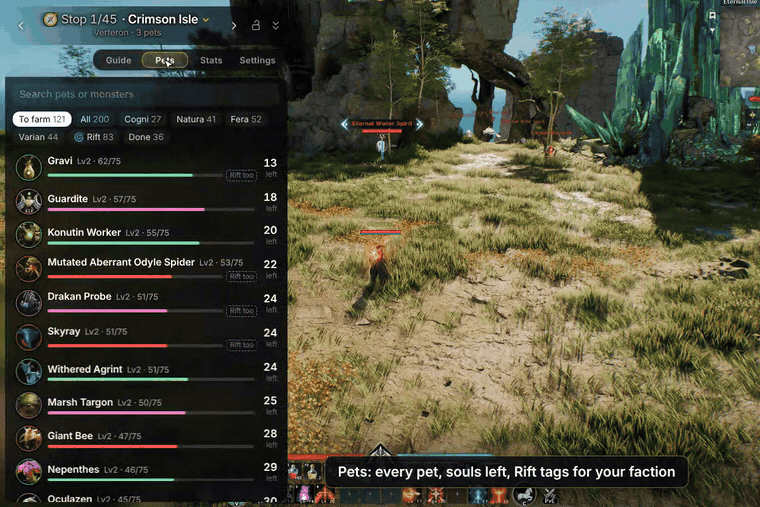
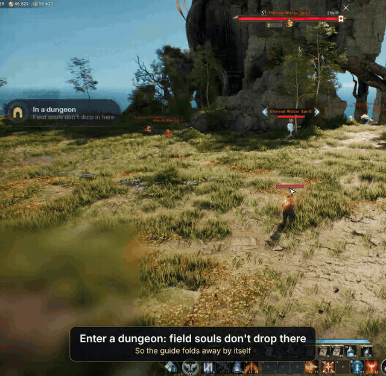

  

  
  
  
  
  

  <b>Stop guessing where pet souls drop.</b> 
  A route over every pet you haven't finished, the monster to kill right now, the way there, and the best loop through the spawns, on top of your game.

---

> [!WARNING]
> **This is a fully vibe-coded side project.** It was built for fun, to make pet farming less painful. Expect bugs, rough edges and the odd wrong spawn. It's free, it's open, and it comes with no promises. If something breaks, [open an issue](../../issues), or better, fix it and send a pull request.

## Contents

- [What it does](#what-it-does)
- [Install](#install)
- [Updating](#updating)
- [Uninstalling](#uninstalling)
- [Is it safe?](#is-it-safe)
- [Troubleshooting](#troubleshooting)
- [Credits](#credits)
- [Contributing](#contributing)
- [Support](#support)

## What it does

The guide needs something that reads the game for it. **Flav-Toolkit is the main way; the A2 Tools DPS Meter is the backup** (its support goes once the project has its own DPS meter). You can switch any time without losing your progress:

| Reads the game | How the guide works with it |
|---|---|
| **[Flav-Toolkit](https://github.com/Flavbestlol/flav-toolkit)** 0.3 or later (**main**) | The guide is one of its add-ons: Flav-Toolkit reads your pet levels and every soul you pick up with the guide's own decoders, its hub lists the guide (Start, Stop, Open, Settings) and its dock shows the paw: click it to open the guide, click again to put it away (Flav-Toolkit 0.12 or later). The overlay keeps your progress. |
| **[A2 Tools DPS Meter](https://a2tools.app)** (backup) | Load the plugin Flav-Toolkit installed in the meter (see [Install](#install)): it reads the same things and keeps your progress; the overlay shows it over the game. |

When both run, the guide reads from Flav-Toolkit and A2 Tools only stands by; if Flav-Toolkit stops, the guide carries on from A2 Tools by itself. *Settings › Overlay › Game records* says which one it uses.

> [!TIP]
> With Flav-Toolkit, the overlay is what records your souls, so keep it running while you farm: turn on **Start with Flav-Toolkit** on the guide's page in Flav-Toolkit's hub. Pet levels are never lost either way (the game sends them at every login), but souls picked up while the overlay is closed only show up after your next login.

| Part | What it does |
|---|---|
| **The overlay** | A small app that draws the guide over AION 2: a tip you place anywhere, which opens into the full guide. Everywhere else, your clicks go to the game. |
| **The plugin** | The guide's decoders (Flav-Toolkit runs them) and, in the A2 Tools meter, the guide itself. |

### A guide that sits on your game

  

- **The tip** shows the monster to kill, how many souls are left and a ring that fills as you farm. On the way to a stop it shows the teleport and an arrow.
- **Click it** and the guide grows out of it. It folds back by itself when you stop hunting, and opens again when you start.
- **Drag it anywhere.** Near a screen edge it snaps, and the whole layout mirrors to face the middle of the screen.
- **Lock it** (<kbd>Ctrl</kbd> + <kbd>Alt</kbd> + <kbd>L</kbd> or the padlock) and every click goes through to the game.
- **Three sizes.** The tip; **compact**, the farming view (the monsters to kill with their pictures, the % ring, souls left, no map); and the **full** guide with the map and tabs. The button by the padlock switches between compact and full, and the header stays where it is: only the bottom moves. Low on the screen, the full guide fits itself into the room under the header (the map gets smaller).
- **It sizes itself.** On the way to a new stop it shows the full guide with the way there, then goes back to compact 3 seconds after your first soul. Drag the guide's corner to make it wider or narrower: compact and full share one width, so a switch only changes the height (it rearranges itself to fit), or hold <kbd>Ctrl</kbd> and scroll over it to resize the whole thing.
- **Rings or bars.** The small button at the end of the monster list switches between round portraits and bars that fill up as you farm, each with its % and the souls left.
- **Make it yours.** Click the pencil by the padlock to edit the layout: drag any part (the monster, the directions, the monster list, the map, the loot strip) anywhere on screen, scroll over it to make it bigger or smaller, or click it for its options (the map's shape, loop and icons; the monster picture's size; rings or bars). Hide what you don't need and bring it back from the bar at the top. Don't want to drag? **Presets** set up a whole layout in one click (Standard, Minimal, Map beside, Big picture), built from where your guide is and how big your screen is. Each part has its own options too: directions as the full route or just the teleport, the loot strip with every drop or only Rare and up, finished monsters in the list or not. Compact and full each keep their own layout, and the parts you moved stay where you put them, even when you drag the guide away.
- **A quick tour** shows new players around once. After an update, only the tips for what's new show, once; tick *Don't show tips again* to turn them off for good.
- **Kill streaks catch fire.** Five souls in a row and the dial starts to smoulder; at 10 it burns, at 20 it blazes, at 40 it turns blue. A fuse under the counter shows how long you have to keep it going.

### Your whole route, one click away

  

- **A route over every unfinished pet**, grouped so you farm several pets at each stop, in the order you choose (by genus, or fewest stops).
- **Click the stop name** for every stop at once, with how far its pets are (%), the souls left and who's there. Search by pet, monster or zone.
- **Three routes, kept apart.** The **main** route stays on your side of the world. The **Abyss** route is one walking loop through Lower Reshanta from your side's base, covering every pet that drops there. The **Rift** route is the other side's map, with the pets you can only get there first.
- **The Abyss.** The pets you can only get there come first; a pet you could also farm at home is marked with a house, and the guide says where (and how many spawn there). When you teleport in, it offers the Abyss route, or tells you every pet in there is done. Its monsters carry the Abyss's own names ("Abyss Coradon" gives Eternal Coradon souls): the guide shows both, and the Pets tab tags each pet *Abyss only* or *Abyss too*.
- **Rift reminders.** Five minutes before each Rift (every 3 hours, in your server's time) it offers the Rift route. When you cross over, it switches by itself, and back when you return.

### The best loop through the spawns

  

- At each stop the map draws **the shortest loop through the densest spawn pockets** of the pets you still need, with arrows showing the way.
- **Your souls tell it where you are.** The pocket you're in glows and the next one lights up.
- As pets finish, the loop rebuilds around what's left.

  

Round or square, resize with the gold grip, or hide the monster icons, all right under the map. To hide the map itself, click it in edit mode and pick Hide.

### Pets, stats and settings

  

- **Pets:** every pet with its level and souls left, with tags for Abyss, Rift and boss pets (they follow your faction). Click one to be guided to its best spots.
- **Stats:** souls per hour, this session and today, and your best farming areas.
- **Settings:** grouped into sections: your character, route, tip and folding, map, look, sound, overlay.

### It knows where you are

  

- **Dungeons and raids:** field souls don't drop inside, so the guide folds away by itself and opens again when you leave. A boss soul names the dungeon and lists the boss souls you still need.
- **Islands:** the first trip to an island goes by Windstream, and the guide tells you where it is.
- **The Abyss:** its own route, from your own base (level 45 and up); stop to stop, it points the way from the last stop.
- **Look-alikes:** it warns you when a monster nearby gives a pet you've already finished.

## Install

You need **Windows 10 or 11** (64-bit) and **AION 2** in Borderless or Windowed mode.

**Pet Farm Guide is a Flav-Toolkit add-on.** Flav-Toolkit installs it, starts it, keeps it up to date and repairs it, like its other add-ons.

1. Install **[Flav-Toolkit](https://github.com/Flavbestlol/flav-toolkit/releases/latest)** (0.3 or later) and follow its own steps (Npcap, run it as administrator, start AION 2 while it runs).
2. In Flav-Toolkit's hub: **Get add-ons › Pet Farm Guide › Install**.
3. On the guide's page in the hub, turn on **Start with Flav-Toolkit**: the overlay is what records your souls, so it should run while you farm.
4. Log in to your character. The game sends your pet levels at login; Flav-Toolkit hands them to the guide even if it starts later.

The overlay shows the guide over AION 2 while you play. Drag the tip where you like, and you're set.

> [!NOTE]
> **Had the guide from its own setup before (1.24.0 or older)?** It tells you once: install it from Get add-ons as above, then remove the old copy in **Windows Settings › Apps › AION 2 Pet Farm Guide › Uninstall** and answer **No** when it asks to delete your data. Your progress lives in your own folder (`%APPDATA%\app.farmguide.overlay`), not in the guide's, so it carries over. The old copy keeps working until then, but gets no more updates.

<b>The A2 Tools DPS Meter as a backup reader</b>

If Flav-Toolkit isn't reading the game, the guide can read from the [A2 Tools DPS Meter](https://a2tools.app) instead (its support goes once the project has its own DPS meter). Load the plugin Flav-Toolkit installed:

1. In the meter: **Settings › Plugins**, switch on **Plugin developer mode**, click **Load plugin folder…**
2. Pick `%APPDATA%\com.flavbest.flav-toolkit\addons\pet-farm-guide\farm-guide` (the folder with `manifest.json` inside).
3. Click **Open** next to the plugin, then go to character select and back in.

Flav-Toolkit keeps that folder up to date; after an update, click **Check for updates** in the meter's plugin list.

## Updating

Flav-Toolkit does it: when a new version is out, its hub says so (the **Get add-ons** tab, the dock's mark, a toast). Click **Update**. **Repair** puts back a missing or changed file, and **Roll back** returns to the version before. Your progress and settings are never touched.

## Uninstalling

In Flav-Toolkit's hub: **Get add-ons › Pet Farm Guide › Remove**. Your progress stays in `%APPDATA%\app.farmguide.overlay`; delete that folder too if you want it gone.

## Is it safe?

Here is exactly what each part does:

- **The plugin** runs in the meter's sandbox. It has no network access. It reads only your own game data: which character you're on (so each one keeps its own progress), your pets' levels, the souls you get, the level-ups, and the id of the map you load. It never sees chat or other players' data. Everything it saves stays on your PC.
- **The overlay** never touches the game. It reads the game records from Flav-Toolkit's local feed (on your PC only, from the overlay's program side: no web page can reach it) or from the plugin's saved files, and keeps its own settings and copy of your progress. **It has no network access at all** (`addon.json` lists none): Flav-Toolkit downloads its updates, checked against Flav-Toolkit's signed catalogue.
- **With Flav-Toolkit**, the guide is an ordinary add-on: Flav-Toolkit runs the guide's own decoders (the same four the plugin has: your pets' levels, the souls you get, level-ups, the map) and nothing else of the guide's. The guide declares what it reads and reaches in its `addon.json`, which Flav-Toolkit's hub shows.
- **Flav-Toolkit builds it** from this repository at a pinned commit, on GitHub's servers, and its hub installs only what its signed catalogue lists, byte for byte. The game's images and map tiles come from a release zip of this repository pinned by its SHA-256 ([`tools/store_build.py`](tools/store_build.py)).
- **It's open.** All the code is in this repository: read it, or build it yourself.

> [!NOTE]
> This is a third-party fan project, not made or supported by NCSOFT or the A2 Tools team. Use it at your own risk.

## Troubleshooting

<b>The meter says "Connecting…" or shows no damage</b>

Start it with **Run as administrator**. If that doesn't help, reinstall [Npcap](https://npcap.com/#download) with **WinPcap API-compatible Mode** ticked. VPNs and ping reducers are fine.

<b>My antivirus flags it</b>

The overlay is new and not code-signed, and some antivirus programs guess wrongly about new programs (Microsoft Defender's guesses end in `!ml`). It's a false alarm: all the code is in this repository, and Flav-Toolkit builds it from here. If your antivirus still blocks it, please [open an issue](../../issues) with its name and the detection name, so it can be reported to that vendor.

<b>The guide says "Waiting for your pets"</b>

Go to character select and log back in, with Flav-Toolkit (or the meter) already running. The game sends your pet list only at login.

<b>The overlay says "Nothing is being recorded"</b>

- **With Flav-Toolkit**: the line after it says what Flav-Toolkit sees (no game found, not reading). Start AION 2 while Flav-Toolkit runs, as administrator.
- **With the meter**: the plugin isn't running. In the meter: **Settings › Plugins**, then **Open** next to the plugin.

<b>Flav-Toolkit's hub doesn't list the guide, or says it's broken</b>

The guide needs Flav-Toolkit **0.3 or later** (older hubs refuse its `decoders`). Update Flav-Toolkit, then open **Get add-ons**. If it says the guide is broken, click **Repair**.

<b>The plugin shows an error when I load the folder</b>

Pick the folder that has `manifest.json` directly inside, not the folder around it.

<b>I can't see the overlay</b>

It shows only while AION 2 is the window in front: click into the game. Still nothing? In the guide, **Settings › Overlay › Show: Always**, or **Reset position** if the tip went off screen. The game must be in Borderless or Windowed mode.

<b>The guide doesn't react to my clicks</b>

It's locked. Click the padlock. With the A2 Tools meter, <kbd>Ctrl</kbd> + <kbd>Alt</kbd> + <kbd>L</kbd> works too: it locks the meter and the guide together.

<b>Something else is wrong</b>

[Open an issue](../../issues) with what you did, what you expected and what happened. A screenshot helps. Please blur other players' names and chat.

## Credits

Built on the work of others. Thank you:

- **[Flav-Toolkit](https://github.com/Flavbestlol/flav-toolkit)**: reads the game for its add-ons, runs the guide's decoders, and its hub and dock.
- **[A2 Tools DPS Meter](https://github.com/taengu/A2Tools-DPS-Meter)** by **taengu** ([a2tools.app](https://a2tools.app)): the meter, its plugin system, and the game-data decoders. The plugin's decoders come from the official [Pet Soul Tracker](https://github.com/taengu/A2Tools-Plugins).
- **Th3Ruthless**, *AION 2 Pet Farming Routes* (Elyos and Asmodian editions): the island Windstreams, the Abyss bases and entry needs, the boss and dungeon sources, and the sources that couldn't be confirmed. We took the routes and tweaked them into the guide.
- **[MetaBot.GG](https://metabot.gg/en/aion-2)**: spawn points, monster art and drop tables.
- **wikily.gg**: the owned effects of each pet genus.

AION 2 is a trademark of NCSOFT. This project isn't affiliated with NCSOFT.

## Contributing

Bug reports, ideas and pull requests are welcome. It's a side project, so answers may take a while.

- **The plugin** is plain HTML, CSS and JavaScript in [`plugin/farm-guide`](plugin/farm-guide). The copy Flav-Toolkit installs has the full folder with images and map tiles (`tools/store_build.py`). To try a change, load the folder in the meter's developer mode and click **Check for updates** after each edit.
- **The overlay** is a [Tauri 2](https://tauri.app) app in [`overlay`](overlay). Its page is built from the plugin by `overlay/assemble.py`; the workspace at the root builds it (`cargo build --release -p farm-guide-overlay`), as Flav-Toolkit's add-on packager does after [`tools/store_build.py`](tools/store_build.py).
- **Where the records come from**: Flav-Toolkit's feed ([`overlay/src-tauri/src/feed.rs`](overlay/src-tauri/src/feed.rs), [`overlay/web/source-feed.js`](overlay/web/source-feed.js)) or the A2 Tools plugin (everything about A2 Tools is in [`overlay/src-tauri/src/a2`](overlay/src-tauri/src/a2) and [`overlay/web/source-a2.js`](overlay/web/source-a2.js), so it can go in one piece). The rules for the player's records: [`overlay/web/records.js`](overlay/web/records.js).
- **Tests** run in CI on every pull request: `python3 tools/check.py`, `node --test tests/js/*.test.js`, the page in a browser (`tests/overlay`), and the Rust parts with no window (`tests/*_core`, one of them against a real Flav-Toolkit feed).
- **A release**: raise the version (`addon.json` and the plugin's `manifest.json` together; `tools/check.py` holds them to it), merge, then ask Flav-Toolkit to move the guide's pinned commit in its catalogue. Flav-Toolkit's CI builds and publishes it.

## Support

The guide is free and always will be. If it saved you some farming time and you'd like to say thanks, you can buy me a coffee:

The same button sits at the bottom of the guide's Settings tab. No pressure: a star on this page or a bug report helps just as much.

## License

[GPL-3.0](LICENSE), like the A2 Tools meter and its plugins.
